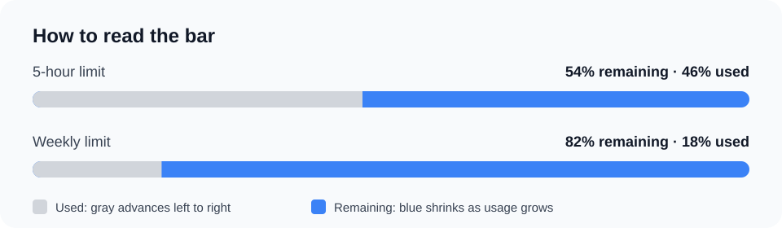

# Codex Usage Widget

[English](README.md) | [简体中文](README.zh-CN.md)

A local-first Windows desktop widget for checking your ChatGPT Codex limits at a glance. Keep the remaining 5-hour and weekly quota, reset times, and earned reset credits visible while you work.

> Independent community software. Not affiliated with, endorsed by, or supported by OpenAI.

## At a glance

- **Blue means remaining.** The blue segment shows the quota left. The gray used segment grows from left to right as quota is consumed.
- **Live account limits.** Reads the rate-limit windows returned by the locally installed Codex CLI app server.
- **Always-on-top desktop widget.** Move and resize the widget, or switch to a compact taskbar label and tray icon.
- **Reset information.** Shows each available window's reset time and earned reset credits when Codex returns them.
- **Local by default.** No separate account, API key, telemetry, or remote usage backend.
- **English and Simplified Chinese.** Also supports system, light, and dark themes.



## What it shows

- Remaining percentage and reset time for the usage windows available to your account, commonly 5 hours and 7 days.
- A selected limit in the widget headline, taskbar label, and tray icon.
- Account credit balance, spend controls, earned reset credits and their expiration details when available.
- Optional token activity and model-specific limits when Codex returns them. Token activity is informational and does not map directly to subscription quota.
- A live activity dot based on Codex lifecycle hooks, if you choose to install and trust those hooks.

The widget refreshes automatically every two minutes and supports manual refresh. The available windows depend on the signed-in account; the app does not invent missing limits.

## Requirements

- Windows 10 version 1809 or newer (Windows 10/11 x64 release builds).
- Codex CLI installed and signed in with the ChatGPT account whose limits you want to view.
- The CLI must be discoverable on `PATH`, or its full path must be set in `CODEX_USAGE_WIDGET_CODEX_PATH`.

Check that the CLI is available in PowerShell:

```powershell
codex --version
```

If Codex is installed outside `PATH`, set the user environment variable to the full path of `codex.exe` or `codex.cmd`, then restart the widget:

```powershell
[Environment]::SetEnvironmentVariable(
  'CODEX_USAGE_WIDGET_CODEX_PATH',
  'C:\Path\To\codex.exe',
  'User'
)
```

The widget relies on the local Codex app-server interface. Changes to that interface may require a widget update.

## Install

Download a Windows x64 archive from this repository's **Releases** page when a release is available. Extract it to a folder you control and run `CodexUsageWidget.exe`. The portable archive includes the .NET runtime; no separate runtime installation is needed.

The executable is not Authenticode-signed, so Windows SmartScreen may show an unknown-publisher warning. Download only from this repository's Releases page and verify the SHA-256 checksum published with the release.

When launched directly from a temporary ZIP location, the app copies itself to `%LOCALAPPDATA%\CodexUsageWidget\app\<version>` and relaunches. When launched from an extracted folder, it continues to run there.

## Read the progress bar

The numeric label is the remaining percentage. In the bar, **blue is the quota remaining** and **gray is the quota already used**. Gray advances from the left as usage increases; the blue remainder contracts from the right. For example, 18% used / 82% remaining is shown as 18% gray on the left and 82% blue on the right.

This layout is a presentation choice. The values come from Codex's returned rate-limit data; the widget does not change or extend your quota.

## Use the widget

- Drag the widget to position it; it stays above other windows.
- Use the quick chevron or **Settings** to switch between compact and detailed layouts.
- In **Settings → Usage**, choose `5h limit`, `Weekly limit`, or `Most constrained` for the headline and tray display.
- Use the `−` button to move the summary to the taskbar. Right-click the taskbar label or tray icon to refresh, change display mode, open settings, check for updates, or exit.
- In detailed mode, expand **Rate-limit resets** to see earned reset credits and their expiry. **Use reset** asks for confirmation and consumes the selected credit.

### Optional activity dots

Activity dots can show whether a local Codex turn is running. They are disabled until you explicitly install and trust the proposed hooks. The widget does not read prompt text, responses, transcript paths, or model output. See [Activity dots](docs/ACTIVITY_DOTS.md) for the exact setup and removal steps.

## Privacy and data

Authentication stays with the Codex CLI. The widget communicates with that local process and does not scrape the browser, ask for an API key, or send session logs to a remote service. There is no telemetry or remote usage backend.

Preferences and diagnostic logs are stored under `%LOCALAPPDATA%\CodexUsageWidget`. Logs are retained locally for 14 days. The widget displays ChatGPT/Codex subscription limits; it does not show OpenAI API billing or API-key usage. Token counts are local activity indicators, not a billing record or a substitute for the account's quota meter.

## Build from source

The repository pins its .NET SDK in [`global.json`](global.json). On Windows, install that SDK and run:

```powershell
dotnet restore .\CodexUsageWidget.slnx
dotnet build .\CodexUsageWidget.slnx -c Release --no-restore
```

To publish a self-contained Windows x64 executable:

```powershell
dotnet publish .\src\CodexUsageWidget\CodexUsageWidget.csproj `
  -c Release -r win-x64 --self-contained true `
  -p:PublishSingleFile=true -p:IncludeNativeLibrariesForSelfExtract=true `
  -o .\artifacts\win-x64
```

The maintainer release script is `scripts/publish.ps1`; it runs the project checks and creates the portable archive. See [Releasing](docs/RELEASING.md) before preparing a release.

For a UI preview with synthetic limits that does not read or consume account usage, close any running widget and run:

```powershell
dotnet run --project .\src\CodexUsageWidget\CodexUsageWidget.csproj `
  -p:EnableUsagePreview=true -- --preview-usage
```

## Uninstall

1. If you installed activity hooks, remove them in **Settings → Features → Codex activity**.
2. Turn off **Start with Windows** in **Settings → General**, if enabled.
3. Exit the widget and delete the extracted application folder.
4. Optionally delete `%LOCALAPPDATA%\CodexUsageWidget` to remove its settings and local logs.

## Attribution and license

This project is a community modification of [ognjeeen/codex-usage-widget](https://github.com/ognjeeen/codex-usage-widget), with the remaining-quota bar presentation adjusted to show used quota advancing from left to right. The original MIT license and copyright notice are retained in [`LICENSE`](LICENSE). Contributions and upstream improvements remain credited to their respective authors.
